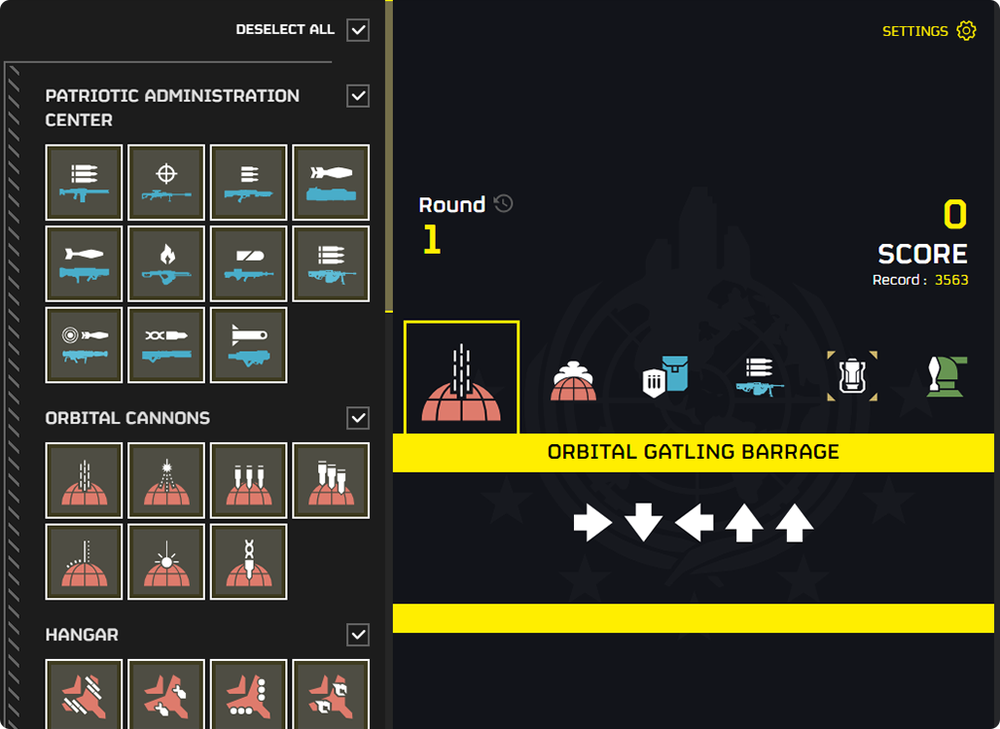
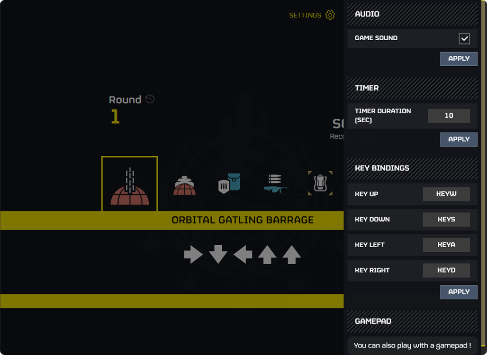
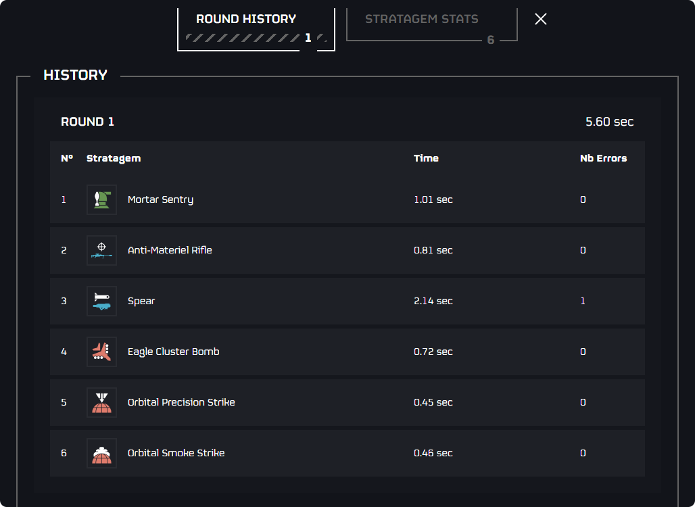

# [Stratagem Hero Trainer](https://stratagem-hero-trainer.vercel.app/)

Turning Average Joes into Stratagem Superstars, Because Even Bugs Fear a Well-Placed Stratagem!

[Stratagem Hero Trainer](https://stratagem-hero-trainer.vercel.app/) 🎮🤖

## Description

Stratagem Hero Trainer is an advanced web application designed to enhance strategic skills through immersive training modules. It provides personalized training plans, real-time feedback, and performance tracking to transform beginners into strategic experts.

## Features

- **Interactive Training Modules**: Engage in dynamic and interactive sessions designed to boost strategic thinking.
- **Real-time Feedback**: Receive instant feedback on your performance to aid continuous improvement.
- **Customizable Training Plans**: Tailor your training schedule to fit your personal goals and progress.
- **User-friendly Interface**: Navigate the application with ease thanks to an intuitive and streamlined design.

## Screenshots

#### Stratagem hero

#### Settings

#### History & Stats

# Support me

### If you find these resources helpful for your projects or simply enjoy the designs, consider supporting my efforts.

## Development Notes

### Adding New Stratagems

When adding new stratagems with their icons to the app:

1. **Add the icon files** to the `public/icons/stratagems/` directory
2. **Add the stratagem data** to the appropriate data files `app/lib/placeholder-data-helldivers`
3. Run `npm run build`: the offline manifest automatically includes public assets and all compiled chunks.

### Offline trainer

After a first online visit and completed service-worker installation, `/` can be reopened
without a connection. Icons, sounds and scripts are precached; settings (including applied
key bindings) and the best score are saved in localStorage. Existing cookies are migrated
when local settings are absent. Loadout offline support is outside this scope.

`npm run build` runs `next build`, then the `postbuild` hook generates
`public/offline-assets.js` using `scripts/generate-offline-assets.js`. This generated
manifest is ignored by Git; `public/sw.js` remains the worker source.

Run a production server with `npm start`, then `npm run cy:offline` to run the offline
scenario alongside the existing Cypress specs. Set `CYPRESS_BASE_URL` for another server.
The spec lives in `cypress/e2e/stratagems-offline.cy.js`; browser lifecycle and network
control live in `cypress/support/offline-browser.js`, registered through `cypress.config.js`.
The support tasks use the Chrome executable selected by Cypress and a temporary profile.
An isolated browser is necessary because Cypress's injected resources prevent its own
page from finishing a reload with the network disabled. The spec keeps all gameplay and
persistence assertions, while the support module only handles browser automation.

The trainer entry point and preference restoration are colocated with the existing
organism in `app/ui/components/organisms/StratagemsGame/StratagemsGameClient.jsx`.
Development mode does not register the worker. Clearing site data removes offline resources
and saved preferences. New builds activate after existing app tabs close.
